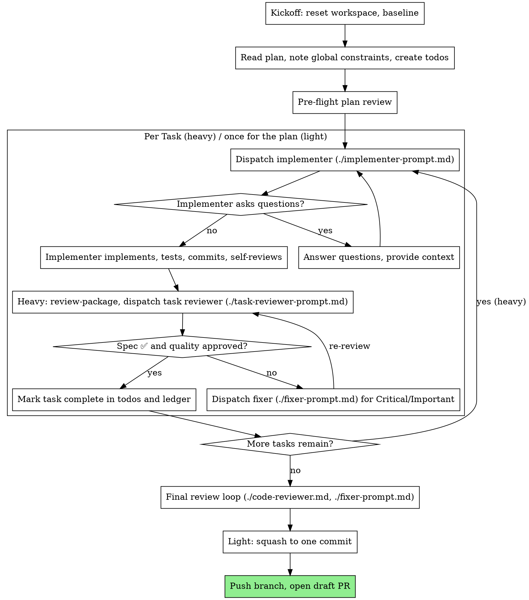

# Subagent-Driven Development

Execute a committed plan with fresh implementer subagents, adversarial
review, and a fix loop whose reviewer never judges its own prescription.
The change ends as a draft pull request; marking it ready and approving
it belong to the human.

The plan's **Tier** header picks the mode:

- **Heavy:** one implementer per task, a task review after each, a commit
  per task, then one whole-branch review.
- **Light:** one implementer for the whole plan, no task reviews, one
  whole-branch review, then everything squashes into a single commit.

Subagents never inherit your session's context: you construct exactly what
each one needs. That keeps them focused and preserves your context for
coordination.

**Continuous execution:** do not pause between tasks to check in. Stop only
for a BLOCKED status you cannot resolve, ambiguity that prevents progress,
a finding tagged ask-user, or completion. Between tool calls, narrate at
most one short line - the ledger and tool results carry the record.

## The Process



## Kickoff

Execution starts when `docs/changes/<id>/plan.md` is committed. The
intent, spec, and plan are already on the branch; this skill adds code.

1. Check for a ledger (see Durable Progress). If one lists completed work,
   this is a resume: skip steps 2-4 and continue where it stops.
2. Require a clean tree (`git status --porcelain` empty) on the change's
   feature branch; otherwise stop and ask. Never execute on main/master.
3. Clear earlier runs' artifacts: `scripts/sdd-workspace --reset`. Stale
   briefs, diffs, and reports otherwise surface in reviewers' greps.
4. Record the base SHA (`git rev-parse HEAD`, the plan commit) and run a
   **baseline**: each verification command the project defines (tests,
   lint, type-check) once, recording pass/fail with a one-line summary of
   each failure. It proves the toolchain resolves and tells every later
   dispatch which failures predate it.

## Pre-Flight Plan Review

Before Task 1, scan the plan once for tasks that contradict each other or
the Global Constraints, and for anything the plan mandates that the review
rubric treats as a defect (a test that asserts nothing, a duplicated logic
block). Present all findings as one batched question, each beside the plan
text that mandates it, asking which governs. If the scan is clean, proceed
without comment.

## Model Selection

- **Implementers and fixers: Sonnet** (mid tier). A well-specified plan
  makes implementation mechanical enough for it, and cheaper models take
  2-3x the turns.
- **Task reviewers and re-reviewers: Opus** (strong tier).
- **Final whole-branch reviewer and its re-reviews: the strongest available
  model** - Fable if the Agent tool offers it, else Opus. It is the one
  dispatch that sees the whole branch.

Only sanctioned deviation: a Sonnet implementer BLOCKED on reasoning depth
is re-dispatched on Opus. Always set the model explicitly - an omitted
model inherits your session's, often the most expensive. If the lineup
changes, map by tier.

## Dispatching an Implementer

**Heavy:** run `scripts/task-brief PLAN_FILE N`; it writes the task's text
to a file and prints the path. **Light:** the plan file itself is the
brief - the implementer works every task in order, committing after each.

Fill [implementer-prompt.md](implementer-prompt.md) with:

- one line on where the task fits;
- the brief path - the single source of requirements, so exact values
  (numbers, strings, signatures, test cases) appear only there;
- the baseline, and (heavy) interfaces and decisions from earlier tasks
  that the brief cannot know, plus your resolution of any ambiguity you
  noticed;
- any plan amendment this dispatch must apply (see Plan Amendments);
- the report path, named after the brief (`task-N-brief.md` ->
  `task-N-report.md`; light: `plan-report.md`);
- the exact Co-Authored-By line from your own session's attribution, or
  subagents substitute their own model name.

A dispatch describes one task, not the session's history: never paste
accumulated summaries of earlier tasks.

## Handling Implementer Status

- **DONE:** heavy: run `scripts/review-package BASE HEAD` (BASE = the SHA
  you recorded before dispatching, never `HEAD~1`, which drops all but the
  last commit) and dispatch the task reviewer with the printed path. Light:
  run the escalation check, then go to Final Review.
- **DONE_WITH_CONCERNS:** read the concerns. Resolve correctness or scope
  doubts before review; note observations and proceed.
- **NEEDS_CONTEXT:** provide it and re-dispatch.
- **BLOCKED:** add context and re-dispatch on the same model; or move to a
  stronger model if it needs more reasoning; or split the task if it is too
  large; or escalate to the human if the plan is wrong. Never retry
  unchanged.
- **No report (the subagent died):** inspect `git status`, `git diff`, and
  the report file. If the edits are complete and the covering tests pass,
  commit and proceed to review. Otherwise resume the same agent
  (SendMessage) with what is done, what remains, and which tests fail - a
  fresh dispatch collides with the half-finished work.

### Light Escalation

After the light implementer reports, run `git diff --name-only
<base>..HEAD | wc -l`. Switch to heavy when the count exceeds the plan's
File Structure by more than 3, or when a non-DONE status reports
ballooning scope or an interface ambiguity the plan did not anticipate.
Run one task review over the commits so far with the plan as the brief
and `plan-report.md` as the report, then dispatch any unfinished tasks one
at a time. Nothing is squashed. Record the switch in the ledger and as a
plan amendment.

## Task Review

Fill [task-reviewer-prompt.md](task-reviewer-prompt.md) with the brief
path, the report path, the review-package path, the review file it writes
(`task-N-review.md`, the fixer's findings input), and the global
constraints that bind the task, copied verbatim (exact values, formats,
stated relationships between components). The template carries the
process rules.

- Do not ask the reviewer to re-run tests the implementer ran, and add no
  open-ended directives ("check all uses") without a task-specific reason.
- Never pre-judge: if your prompt contains "do not flag", "at most Minor",
  or "the plan chose", you are sparing yourself a review loop. Let the
  reviewer raise it and adjudicate afterwards.

## Handling Findings

Findings are claims, not verdicts. Verify each against the code before
acting, push back with technical reasoning when one is wrong, and never
respond performatively ("Great catch!"). If a finding is unclear, get it
clarified before fixing anything - findings are often related, and partial
understanding produces wrong fixes. Treat an implementer's rebuttal the
same way.

- **Critical and Important:** one fixer with
  [fixer-prompt.md](fixer-prompt.md) and the complete list, then a
  re-review by a fresh reviewer. Create `.minipowers/sdd/fix-round` before
  the dispatch and delete it after: a repo hook can deny test-file edits
  while it exists. Re-dispatch the reviewer only once the fixer's
  verification evidence is in the report file.
- **ask-user:** the reviewer tags a finding ask-user when its smallest
  honest remedy would extend the change (new state, schema, retry or
  persistence machinery, a subsystem), when it contradicts the spec's
  intent, or when a component the spec does not require should be removed.
  Never hand these to a fixer unruled. Batch them into one question for
  the human with your recommendation per item; a finding ruled "fix"
  becomes a plain finding for the next fixer, the rest are dropped or
  amend the spec. Every ruling is a plan amendment. Plan-mandated defects
  and conflicts with the plan's text are ask-user too.
- **The spec itself is wrong:** decide it yourself if the fix restores the
  spec's stated intent. Ask the human (one batched question with a
  recommendation) when it changes a published default, a threshold, or an
  output's meaning. Either way, amend the plan, and the spec when its
  stated intent was wrong.
- **Minor:** never a per-task round-trip. Record each in the ledger; the
  final reviewer triages the list for the final fix wave.
- **⚠️ Cannot verify from diff:** resolve each yourself before marking the
  task complete - you hold the cross-task context. A real gap is a failed
  spec review.

### Plan Amendments

The plan describes what was built; the PR review checks the diff against
it. Every deviation from the plan and every human ruling during execution
is appended to the plan's `## Amendments` section: what changed, why,
which task, and the ruling if a human made one. You write the entry. When
a dispatch implements the change, it applies the entry in the same commit
through the prompt's `[AMENDMENT]` block. When nothing in the code changes
(a finding dropped, an escalation, a spec correction), you append it
yourself and commit `docs: amend plan - <what>`; a spec whose stated
intent was wrong is corrected in that same commit. The ledger is scratch
memory and does not record decisions.

### Re-review Rounds

A re-review is a fresh dispatch of the same reviewer template; it never
resumes the reviewer that prescribed the fixes, or it would certify its own
prescription. Fill the template's Fix Round block with the round number,
the fix-round commit range, and the fixer's report.

A prior finding is **resolved** only when the re-review says so and reports
nothing else in that file. Silence or a reworded finding in the same file
leaves it open. In the final review, a **Reviewed** list that misses a
changed file is an incomplete review: re-dispatch for exactly the missing
files and merge, never treat the gap as clean.

Stop and ask the human when a re-review finds that fix-round code grew past
what the finding required (the reviewer recommends reverting the round to a
minimal fix) or when three fix rounds have not converged. Never move to
the next task while Critical or Important findings are open.

## Final Review

1. Invoke `/simplify` through the Skill tool if the harness offers it,
   scoped to the branch's code changes, and commit what it changed
   (`git add -u`, `refactor: simplify <area>`). This is the one sanctioned
   controller edit: its output lands before the review so the reviewer
   judges it.
2. If the branch adds a statistical gate or self-check, run it over ~100
   seeds and report the failure rate; 1-2% failures at default config is a
   defect.
3. Run the full suite and lint once at HEAD, output to
   `.minipowers/sdd/full-suite-<head7>.txt`. Failures also present in the
   baseline are reported, not blockers; anything newly red blocks.
4. Run `scripts/review-package BASE HEAD` with the base SHA recorded at
   Kickoff.
5. Dispatch exactly one final reviewer with
   [code-reviewer.md](code-reviewer.md): the package path, the spec and
   plan, `REVIEW.md` at the repo root if it exists, the baseline, the
   full-suite output path, `git diff --name-only BASE..HEAD` as the
   changed-file list, the ledger's Minor list, and a findings file
   (`.minipowers/sdd/review-findings-BASE..HEAD.md`).
6. Findings follow Handling Findings and Re-review Rounds: one fixer with
   the complete list, reporting to `.minipowers/sdd/fix-report-round-N.md`,
   then a fresh re-review that receives that report.
7. If fixes changed code since step 3, run the full suite once more.
8. Run minipowers:verification-before-completion.
9. **Light, unless escalated (see the ledger):** squash the implementation
   commits onto the plan commit:
   ```
   git reset --soft <base SHA>
   git commit -m "<type>: <description>" -m "<Co-Authored-By trailer>"
   ```
   Conventional Commits subject, no body beyond the trailer. Never squash
   with open Critical or Important findings or an unanswered ask-user.
10. Push the branch and open a draft PR. Write the body to
    `.minipowers/sdd/pr-body.md` first, then try in order and stop at the
    first that works:
    1. `gh pr create --draft --body-file <path>` if `gh` is installed and
       `gh auth status` passes.
    2. A GitHub MCP tool in this session that creates pull requests, with
       `draft: true`.
    3. The REST API when `GH_TOKEN` or `GITHUB_TOKEN` is set:
       `POST /repos/<owner>/<repo>/pulls` with `draft: true`, owner and
       repo parsed from the remote URL.
    4. Other hosts: `glab mr create --draft` on GitLab when authenticated.
    5. Otherwise print the remote's compare URL and the body path, and ask
       the human to open the draft.

    Body sections, in order: **Intent** (link to `intent.md`, one-line problem), **What
    changed**, **Plan deviations** (the Amendments list, or none),
    **Review** (the final Assessment line; Critical and Important findings
    fixed; Minors left and why; CLAUDE.md proposals), **Verification**
    (each command and its one-line result), **Decisions** (every human
    ruling during execution). End with the attribution the session
    requires. Never mark it ready, never merge, and never offer to: the
    human reads the PR, marks it ready, and approval is a code owner's
    through branch protection. If there is no remote, say so and stop.

If a review ends without a report, read its findings file first and
re-dispatch only for what it does not cover, handing the file over to be
amended.

## Durable Progress

Conversation memory does not survive compaction; the costliest observed
failure is re-dispatching completed tasks. Keep a ledger at
`.minipowers/sdd/progress.md`:

- At start, read it. Work marked complete is done - never re-dispatch it.
- When a task's review comes back clean, append
  `Task N: complete (commits <base7>..<head7>, review clean)`. Light:
  `Implementation: complete (<base7>..<head7>)`, then one line per review
  round.
- Record Minor findings under a "Minors" heading as they arrive.
- Decisions and deviations are not ledger entries: they go to the plan's
  Amendments (committed) and the PR body.
- After compaction, trust the ledger and `git log` over recollection. If
  `git clean -fdx` destroyed the ledger, recover from `git log`.

## Never

- Skip task review on the heavy tier, or accept a review missing either
  verdict
- Dispatch implementers in parallel - they share one checkout
- Make a heavy-tier subagent read the whole plan - hand it its task brief
- Fix a subagent's work yourself - dispatch a fixer; `/simplify` in Final
  Review is the one exception
- Let implementer self-review replace review
- Resume a reviewer across a code change
- Hand an ask-user finding to a fixer
- Run, or let any dispatch run, repo-wide format or lint autofix -
  path-scoped only
- Merge the branch, or leave a deviation out of the plan's Amendments
- Edit or weaken an existing test to make it pass, or let a dispatch do so
